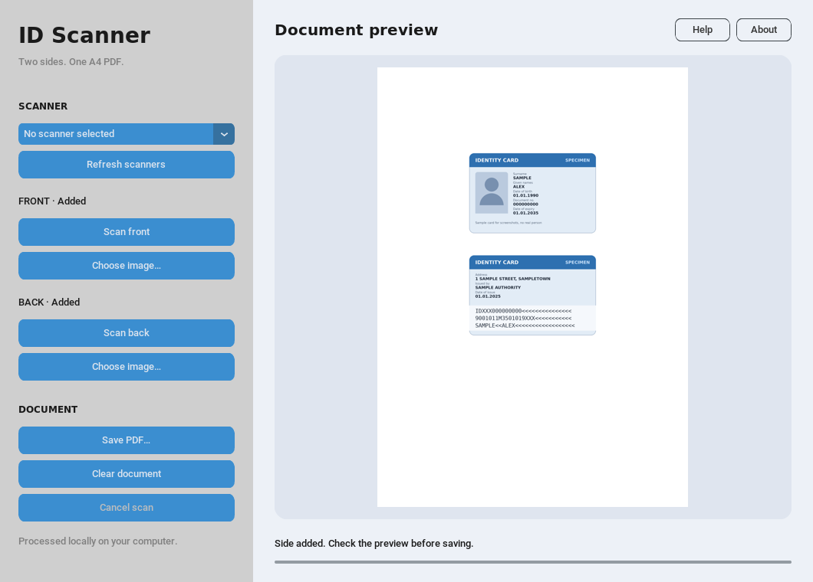
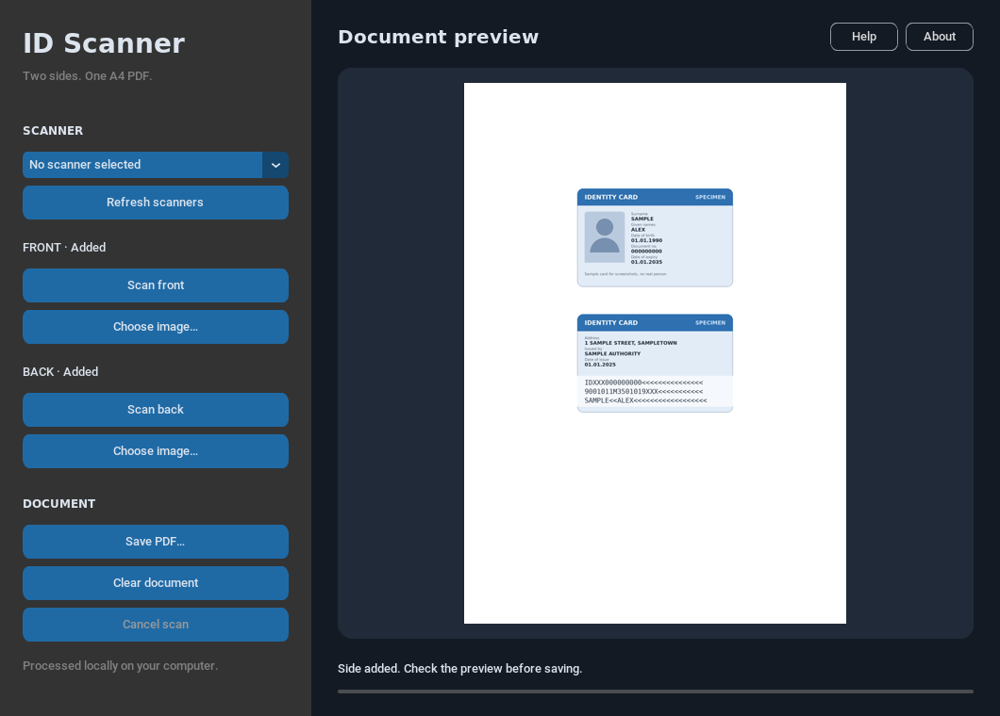

# ID Scanner

Scan the front and back of an ID card and save both sides on one A4 page as a PDF,
at the card's real size, like a photocopy. Photos or scans you already have work too:
the card is found, straightened and cut out of the image.

| Light | Dark |
|---|---|
|  |  |

It works with any card of ID-1 size (85.6 × 54 mm): ID cards, driving licences, health
insurance cards, residence permits. Everything happens on your computer; nothing is uploaded.
The card detection comes from [id2pdf](../id2pdf).

| | Scan with a scanner | Use existing images |
|---|---|---|
| Linux | yes, with SANE | yes |
| Windows, macOS | no | yes |

## Install

You need Python 3.11 or newer with Tk, and the `id2pdf` and `idscanner` folders next to
each other in the same directory.

### 1. Python and Tk

- **Windows:** install Python from [python.org](https://www.python.org/downloads/); Tk is included.
- **macOS:** the [python.org](https://www.python.org/downloads/) installer includes Tk.
  With Homebrew Python, also run `brew install python-tk`.
- **Linux:** install your distribution's Tk package for Python:

  | Distribution | Command |
  |---|---|
  | Debian, Ubuntu, Mint | `sudo apt install python3-tk` |
  | Fedora | `sudo dnf install python3-tkinter` |
  | Arch, Manjaro | `sudo pacman -S tk` |
  | openSUSE | `sudo zypper install python3-tk` |

### 2. SANE, for scanning (Linux only)

| Distribution | Command |
|---|---|
| Debian, Ubuntu, Mint | `sudo apt install sane-utils` |
| Fedora | `sudo dnf install sane-backends` |
| Arch, Manjaro | `sudo pacman -S sane` |
| openSUSE | `sudo zypper install sane-backends` |

Check that your scanner shows up with `scanimage -L`. Without SANE the app still opens
and works with image files; **Refresh scanners** explains what to install.

### 3. ID Scanner

With [uv](https://docs.astral.sh/uv/), from the directory that holds both folders:

```
uv tool install ./idscanner
```

On Linux, add `--python-preference only-system`: the Python builds that uv downloads come
with a Tk that cannot draw smooth fonts or rounded corners there.

Without uv, use a virtual environment:

```
python3 -m venv idscanner-env                               # Windows: py -m venv idscanner-env
idscanner-env/bin/pip install ./id2pdf ./idscanner          # Windows: idscanner-env\Scripts\pip
```

Then start it with `idscanner` (or `idscanner-env/bin/idscanner`, on Windows
`idscanner-env\Scripts\idscanner`).

## Use

1. Choose your scanner. The app looks for scanners when it starts and remembers your choice;
   click **Refresh scanners** after connecting or switching on a scanner.
2. Put the card face down on the glass, anywhere and with its text upright, and close the lid.
3. Click **Scan front**, turn the card over, then click **Scan back**.
4. Check the preview and click **Save PDF…**.

Either side can be scanned again or replaced on its own. **Choose image…** loads a photo or
scan from disk instead; if the whole image appears rather than just the card, use a clearer
picture or crop it first.

Print the PDF at 100 % / "actual size", not "fit to page", so the card keeps its real size.

**Cancel scan** stops a running scan; a scan also gives up after three minutes.
A failed save never overwrites an existing PDF. **Help** (F1) shows these steps in the app.
**About** lets you choose a light or dark theme, or follow the system; the choice is remembered.

## Development

```
uv sync
uv run pytest
uv run ruff check . && uv run ruff format --check .
```

`src/idscanner/icon.png` and `icon.ico` are drawn by `tools/make_icon.py`;
run `uv run python tools/make_icon.py` after changing it.

## License

GPL-3.0-or-later; see `LICENSE`. id2pdf uses the same license.
